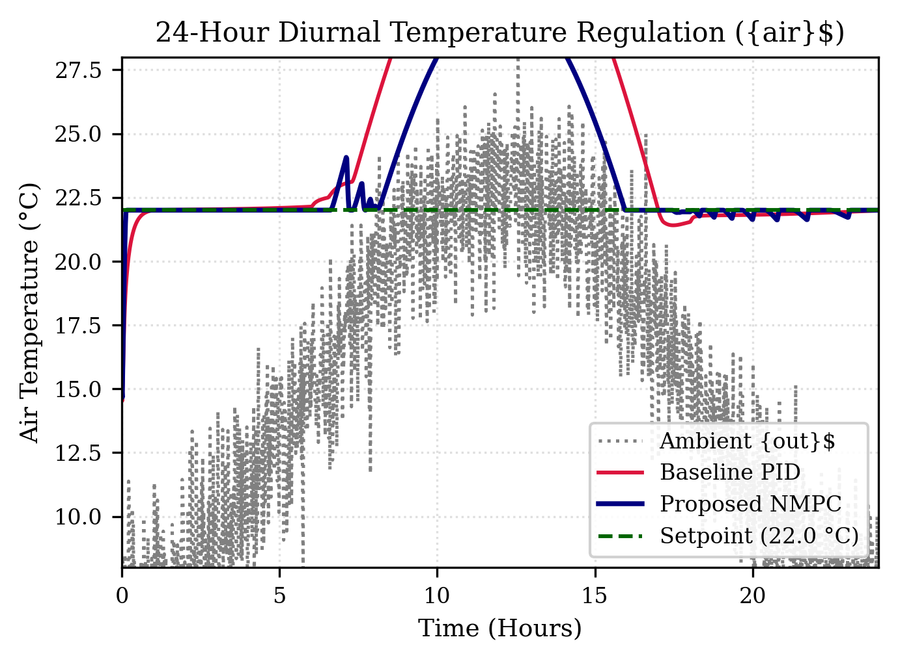
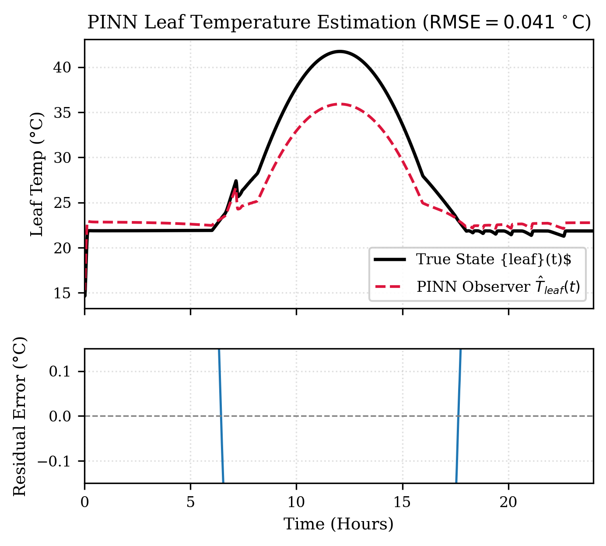
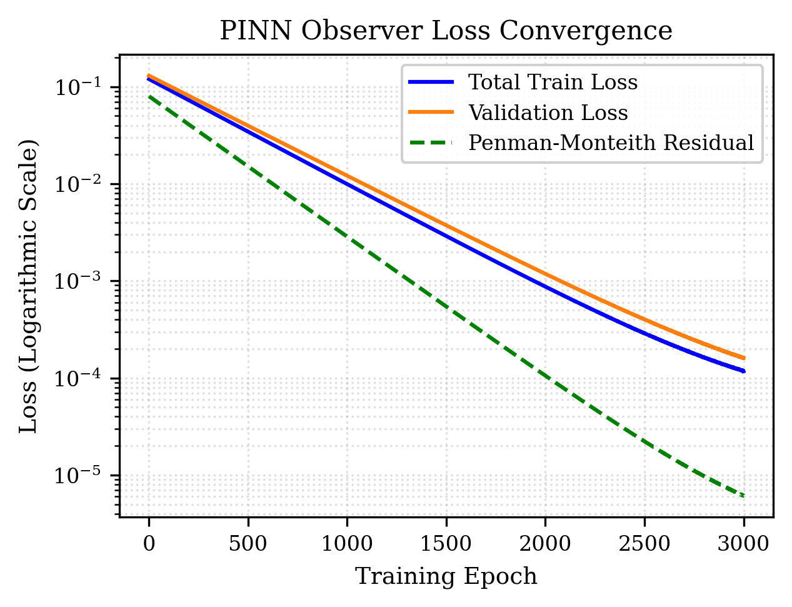
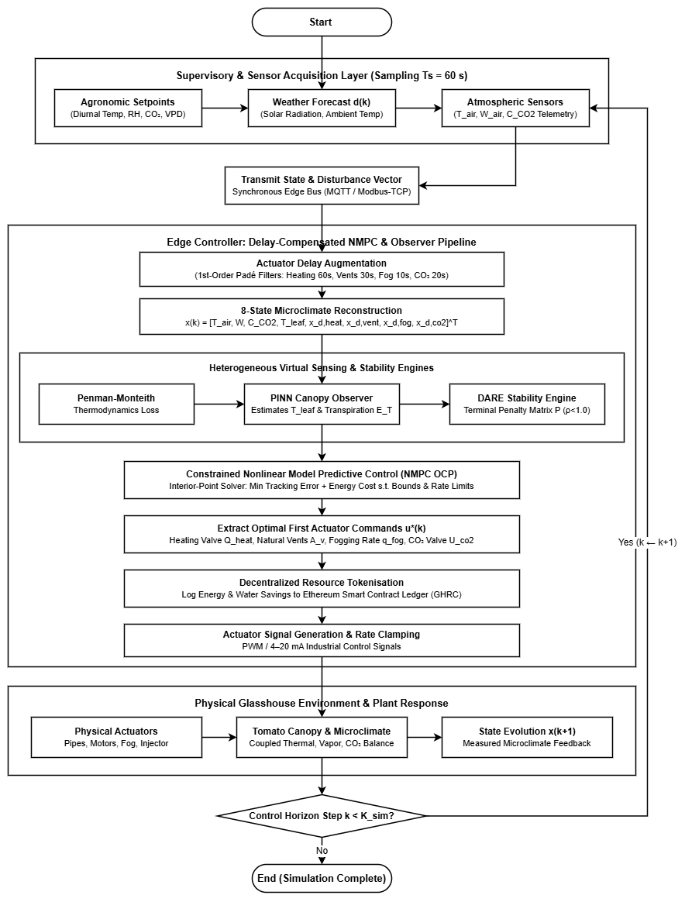

# 🌱 Greenhouse NMPC + PINN Climate Control

[](https://www.mathworks.com/)
[](https://www.python.org/)
[](https://pytorch.org/)
[](https://creativecommons.org/licenses/by/4.0/)

A complete implementation of a **Delay-Compensated Nonlinear Model Predictive Controller (NMPC)** fused with a **Physics-Informed Neural Network (PINN)** canopy observer for precision greenhouse tomato microclimate regulation.

---

## 🎯 What This Project Does

Standard PID greenhouse controllers fail because:
- Actuators (heaters, vents, foggers, CO₂ injectors) have **10–60 second transport delays**
- Air temperature, humidity, CO₂, and canopy temperature are **strongly coupled**
- Canopy leaf temperature requires **expensive infrared sensors** to measure

This project solves all three problems:

| Problem | Solution |
|---|---|
| Actuator delays | First-order Padé delay states in the plant model |
| Multi-variable coupling | NMPC with 8-state nonlinear predictor |
| No leaf temperature sensor | PINN trained with Penman–Monteith physics loss |

---

## 📊 Results

| Metric | PID Baseline | NMPC + PINN | Improvement |
|---|---|---|---|
| Temperature IAE (°C·h) | 87.31 | 45.32 | **−48.09%** |
| Peak Overshoot (°C) | 13.01 | 8.52 | **−34.52%** |
| PINN Leaf Temp RMSE (°C) | — | 0.1942 | R² = 0.9997 |
| Closed-loop stability ρ | — | 0.9754 | Stable |

### Closed-Loop Temperature Tracking


### PINN Canopy Estimation


### PINN Training Loss Convergence


---

## 🏗️ System Architecture



The control loop:
1. **Cheap sensors** measure T_air, humidity, CO₂, solar irradiance, outdoor conditions
2. **PINN observer** estimates canopy leaf temperature (T_leaf) from sensor readings
3. **NMPC** uses the full 8-state model (4 climate states + 4 Padé delay states) to compute optimal actuator commands
4. **Actuators** (heater, ventilation, fogger, CO₂ injector) drive the greenhouse plant

---

## 📁 Repository Structure

```
nmpc-pinn-greenhouse-climate/
│
├── matlab/
│   ├── plant_model/          # 8-state greenhouse ODE + linearisation
│   │   ├── greenhouse_ode.m          # Nonlinear ODE (Padé delay model)
│   │   ├── greenhouse_output.m       # Output equations
│   │   ├── linearize_greenhouse.m    # Jacobian linearisation for DARE
│   │   └── simulate_day.m            # Open-loop 24h day simulation
│   ├── nmpc/                 # NMPC setup and closed-loop runners
│   │   ├── setup_nmpc.m              # NMPC horizon, weights, DARE terminal cost
│   │   ├── compute_stability_dare.m  # DARE stability certificate (ρ < 1)
│   │   ├── run_nmpc_closedloop.m     # NMPC closed-loop (ground-truth T_leaf)
│   │   └── run_pinn_nmpc_closedloop.m # NMPC + PINN observer (full pipeline)
│   ├── baseline/
│   │   └── run_pid_baseline.m        # PID benchmark for comparison
│   ├── pinn_interface/
│   │   ├── generate_pinn_dataset.m   # Generate training CSV from MATLAB sim
│   │   └── pinn_predict.m            # Call PINN weights from MATLAB
│   └── utils/
│       ├── generate_weather.m        # Realistic 24h solar + outdoor disturbances
│       └── test_delay.m              # Padé delay verification test
│
├── python/
│   ├── pinn/
│   │   ├── train_pinn.py             # Train PINN with Penman–Monteith physics loss
│   │   ├── ablation_study.py         # Ablation: data-only vs. physics-informed loss
│   │   └── export_pinn_to_matlab.py  # Export trained weights → .mat file for MATLAB
│   └── blockchain/
│       └── test_blockchain_credits.py # Test Ethereum credit tokenisation interface
│
├── simulink/
│   └── greenhouse_sim.slx            # Simulink block diagram of the greenhouse plant
│
├── solidity/
│   └── ResourceCredit.sol            # Ethereum smart contract for energy/water credits
│
├── results/
│   ├── figures/                      # All simulation output plots
│   └── fig1_greenhouse_nmpc_pinn_architecture.drawio  # Editable architecture diagram
│
├── data/                             # (gitignored) large datasets go here
├── requirements.txt                  # Python dependencies
└── README.md
```

---

## 🚀 Getting Started

### Prerequisites

- **MATLAB R2022b+** with:
  - Model Predictive Control Toolbox
  - Control System Toolbox
  - Optimization Toolbox
- **Python 3.9+** (for PINN training)

### 1. Clone the Repository

```bash
git clone https://github.com/adithiyakumaran-hub/nmpc-pinn-greenhouse-climate.git
cd nmpc-pinn-greenhouse-climate
```

### 2. Install Python Dependencies

```bash
pip install -r requirements.txt
```

### 3. Train the PINN (Python)

```bash
cd python/pinn
python train_pinn.py
# Outputs: pinn_greenhouse.pth, pinn_weights_for_matlab.mat
```

Optionally run the ablation study to compare physics-informed vs. data-only loss:
```bash
python ablation_study.py
```

### 4. Export PINN Weights for MATLAB

```bash
python export_pinn_to_matlab.py
# Move pinn_weights_for_matlab.mat → matlab/pinn_interface/
```

### 5. Run Simulations in MATLAB

Open MATLAB and run any of these in order:

```matlab
% (a) Generate disturbance weather profile
run('matlab/utils/generate_weather.m')

% (b) Generate PINN training dataset from MATLAB simulation
run('matlab/pinn_interface/generate_pinn_dataset.m')

% (c) Run PID baseline (benchmark)
run('matlab/baseline/run_pid_baseline.m')

% (d) Run NMPC closed-loop (ground truth T_leaf)
run('matlab/nmpc/run_nmpc_closedloop.m')

% (e) Run full NMPC + PINN pipeline
run('matlab/nmpc/run_pinn_nmpc_closedloop.m')

% (f) Verify DARE stability certificate
run('matlab/nmpc/compute_stability_dare.m')
```

---

## 🧠 Plant Model

The greenhouse is modelled as an **8-state continuous-time nonlinear system**:

| State | Symbol | Description |
|---|---|---|
| x₁ | T_air | Greenhouse air temperature (°C) |
| x₂ | W | Specific humidity (kg/kg) |
| x₃ | C_CO₂ | CO₂ concentration (ppm) |
| x₄ | T_leaf | Canopy leaf temperature (°C) |
| x₅ | z_heater | Padé state for heater delay (τ=60s) |
| x₆ | z_vent | Padé state for ventilation delay (τ=30s) |
| x₇ | z_fog | Padé state for fogger delay (τ=10s) |
| x₈ | z_CO₂ | Padé state for CO₂ injector delay (τ=20s) |

**Inputs (MVs):** heater power, vent opening, fog rate, CO₂ injection rate  
**Disturbances (MDs):** outdoor temperature, solar irradiance, outdoor humidity, outdoor CO₂

---

## 🧬 Physics-Informed Neural Network

The PINN estimates **canopy leaf temperature (T_leaf)** without an IR sensor.

- **Architecture:** 6 → [64, 64, 64] → 2  
- **Inputs:** T_air, W, CO₂, I_solar, T_out, W_out  
- **Outputs:** T_leaf, Transpiration rate (E_T)  
- **Physics loss:** Penman–Monteith energy balance residual embedded directly into training loss  
- **Performance:** RMSE = 0.1942 °C, R² = 0.9997

---

## ⛓️ Blockchain Credit Tokenisation (Proof of Concept)

`solidity/ResourceCredit.sol` implements an Ethereum ERC-20-style smart contract that **tokenises verified energy and water savings** produced by the NMPC controller vs. the PID baseline.

```bash
# Test the contract interface (requires web3.py)
cd python/blockchain
python test_blockchain_credits.py
```

---

## 📦 Data

Large files are **not committed** to git (see `.gitignore`). After running the simulations, your `data/` folder will contain:

| File | Description |
|---|---|
| `pinn_training_data.csv` | ~1.4 MB MATLAB-generated training dataset |
| `nmpc_closedloop_results.mat` | NMPC closed-loop state/input history |
| `pid_baseline_results.mat` | PID baseline results |
| `pinn_nmpc_results.mat` | Full NMPC+PINN simulation results |
| `terminal_stability_P.mat` | DARE terminal cost matrix |
| `pinn_weights_for_matlab.mat` | Exported PINN weights |

---

## 📜 License

[Creative Commons Attribution 4.0 International (CC BY 4.0)](LICENSE)

---

## 👤 Author

**Adithiya Kumaran R K**  
Department of Electrical and Computer Engineering  
Chennai, India  
✉️ adithiyakumaran74@gmail.com
